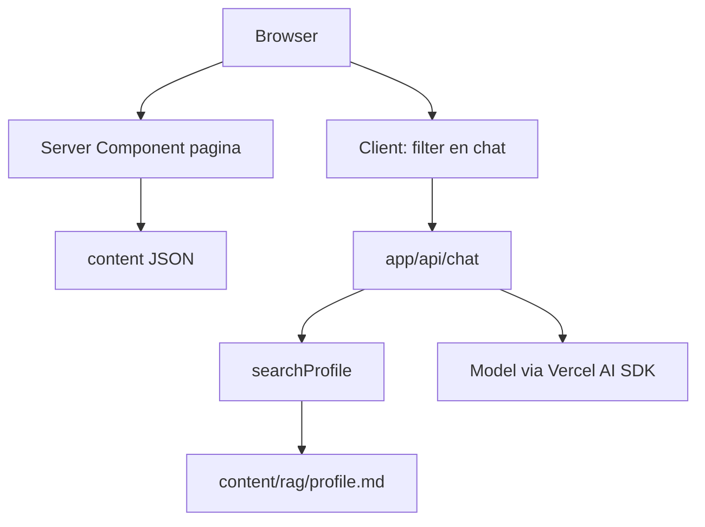

# Portfolio

Deze site is een herbouw van een Angular 16-portfolio. Het doel is niet een visuele kopie, maar een kleine applicatie waarvan je kunt uitleggen waar de data leeft, hoe de staat gedeeld wordt, en waar een model wel en niet bij mag.

De pagina is React op de Next.js App Router. De vorm volgt het oude ontwerp: bordeaux, Raleway en Mulish, kaarten en een tijdlijn. De stijl staat in Tailwind, als tokens in `app/globals.css`. Eén stylingsysteem is genoeg. Een tweede componentbibliotheek zou de look namaken die Tailwind hier al vastlegt.

## Wat de architectuur moet laten zien

Drie grenzen zijn bewust klein gehouden.

De pagina is een document. Persoonsgegevens, skills, projecten en banners komen uit JSON op de server. De browser haalt die bestanden niet op en praat niet met een content-API. Leeftijd en aantal jaar als developer worden bij het renderen uit datums afgeleid, zodat de tekst niet veroudert doordat iemand een getal in de JSON vergeet bij te werken.

Het filter is URL-staat. `/?keywords=Angular&keywords=React#werk` is de selectie. Een lege selectie toont alles. Meerdere trefwoorden zijn een OF-filter, zoals in de oude store. Onbekende trefwoorden vallen weg. De eerste response filtert op de server. Een klik werkt de lijst bij zonder de viewport te verplaatsen: de client schrijft dezelfde URL met `scroll: false`, en de terugknop synchroniseert via `popstate`. De link wijst naar `#werk`, zodat een gewone paginaload bij de lijst uitkomt.

De chat is een eiland in dezelfde app. Het venster rechtsonder praat alleen met `app/api/chat`. Model en sleutel blijven in de omgeving. Het model mag feiten over de persoon alleen ophalen via een tool, uit één markdownbestand.



## Eén Next.js-app

Pagina, content, chatroute en profielindex draaien in hetzelfde proces. Dat is een monoliet, en hier is dat de betere grens.

Een monorepo loont als pakketten een eigen release hebben of als meerdere apps dezelfde bibliotheek delen. Deze site heeft één deploy en geen tweede consument van de index. Een package boundary zou types en scripts splitsen zonder een eigenaar te geven.

Een aparte Node-server voor het model loont als meer producten hetzelfde model gebruiken, als dat proces apart moet schalen, of als het model buiten het webproces moet blijven. Deze chat bestaat alleen voor deze pagina. Een tweede server betekent een tweede deploy, CORS, en een sleutel op nog een plek. De Vercel AI SDK streamt vanuit een Route Handler. De browser ziet alleen `/api/chat`.

`server-only` op de modules die bestanden lezen laat de build stuklopen als een clientcomponent ze per ongeluk importeert. De domeinregels in `lib/` importeren geen React. Daardoor zijn leeftijd, filter, id's en de profielindex te testen zonder de pagina op te bouwen.

## Van bestand naar pagina

`lib/content.ts` leest `content/*.json` van schijf. `lib/parse-content.ts` controleert de vorm. Die scheiding maakt de validatie testbaar zonder het filesystem, en de loader testbaar tegen de echte voorbeeldbestanden.

`lib/page-model.ts` maakt daar een paginamodel van: leeftijd, jaren als developer, skillgroepen, trefwoorden en de gefilterde projecten. Project-id's zijn de volgorde in het bestand plus één. De pagina zelf rendert dat model. Alleen het filter en de chat zijn clientcomponenten, omdat alleen die interactie hebben na de eerste response.

## Chat en streaming

`components/chat-widget.tsx` is het venster. `useChat` stuurt het gesprek naar de route. De route roept `streamText` aan en geeft de stream terug als UI-messagestream. Tokens komen binnen terwijl het model nog schrijft.

`AI_MODEL` is het model-id. `claude-haiku-5-5` in `.env.example` is een voorbeeld, geen keuze die in de code vastzit. `AI_API_KEY` gaat naar de Anthropic-provider op de server. De route weigert het verzoek als een van beide ontbreekt, en het venster toont die zin in plaats van een rauwe JSON-body.

Binnenkomende berichten worden gecontroleerd: alleen gebruiker en assistent, een begrensd aantal, alleen tekst, en een maximumlengte. Tool-onderdelen uit de browser worden weggegooid. Anders kan een client een verzonnen toolresultaat in de geschiedenis zetten en het model laten doen alsof het profiel dat zei.

`stopWhen: isStepCount(4)` laat het model een tool aanroepen en daarna nog antwoorden, en kapt een lus af voordat een vastgelopen gesprek de sleutel blijft gebruiken.

## Profiel als RAG, zonder vectordatabase

`searchProfile` is een tool van de Vercel AI SDK. Het model moet die tool aanroepen voordat het iets over de persoon beweert, en het mag alleen de teruggegeven fragmenten gebruiken.

Het bestand is `content/rag/profile.md`. Koppen worden chunks. Een vraag wordt op woorden gezet, stopwoorden vallen weg, en de drie best passende chunks gaan terug. Een treffer in de kop weegt zwaarder. De index blijft in het geheugen en wordt opnieuw gebouwd als pad, wijzigingstijd of grootte verandert. Het bestand vervangen op de server is genoeg. De code hoeft niet opnieuw gebouwd te worden om de nieuwe tekst te zien.

Dit is retrieval-augmented generation in de kleine vorm. Het model krijgt niet het hele profiel in de systeemprompt, maar de stukken die bij de vraag horen. Een vraag die niets raakt, levert geen fragmenten op, en de instructie is dan om te zeggen dat het niet in het profiel staat.

Een embeddingmodel en een vectordatabase zijn hier een tweede systeem voor één kort bestand. Lexicale overlap op koppen is uitlegbaar, testbaar, en heeft geen extra sleutel. Dezelfde toolgrens blijft staan als het corpus later groot genoeg wordt voor embeddings: de route blijft `searchProfile` aanroepen, de index erachter kan dan veranderen.

`RAG_DOCUMENT_PATH` mag een andere bestandsnaam in `content/rag` zijn. Een pad met een map of `..` wordt geweigerd. Daardoor kan een deploy het bestand niet laten wijzen naar iets buiten die map, en traceert de bundler die map in plaats van de hele repository.

De tekst in de repository is een placeholder. De HTML-commentaar bovenin wordt vóór het indexeren verwijderd, zodat de deploy-instructie niet in een antwoord belandt. Vervang het bestand bij het deployen door de echte tekst.

## Tests

`npm test` draait Vitest.

Domeintests dekken datums, het filter, project-id's, de contentvalidatie en de profielindex, inclusief een vervangen bestand en een pad dat buiten de map wijst. Componenttests dekken de kaart, de skills, het filter en het chatvenster, ook de regel die verschijnt terwijl de tool zoekt.

De routetest controleert dat `searchProfile` aan de stream hangt en dat een zoekopdracht op "opleiding" het opleidingsfragment teruggeeft. Een tweede test stuurt een nagebootste Anthropic-stream door de echte SDK en controleert dat de tekst in het antwoord naar de browser zit en de sleutel niet.

## Lokaal draaien

```bash
npm install
cp .env.example .env.local
npm run dev
npm test
npm run typecheck
npm run build
```

`.env.local`:

```
AI_MODEL=claude-haiku-5-5
AI_API_KEY=
```

Zonder die twee variabelen werkt de pagina. De chat antwoordt dan dat model en sleutel gezet moeten worden.

## Content vervangen

De JSON in `content/` is voorbeeldcontent. De oorspronkelijke Angular-app verwees naar bestanden die niet in de repo stonden. De twee campagnes in de banners komen uit de oude `BannerService`.

- `content/personal.json` — profiel. `${age}` en `${yearsAsDeveloper}` in `foreword` worden op de server ingevuld vanuit `dateOfBirth` en `developingStartDate`.
- `content/skills.json` — `category` is `skills`, `framework` of `other`.
- `content/projects.json` — de id is de volgorde in het bestand plus één.
- `content/banners.json` — paden onder `/images/`.
- `content/rag/profile.md` — de tekst die de chat mag gebruiken. Placeholder, vervangen bij deploy.

Beelden staan in `public/images/`.
