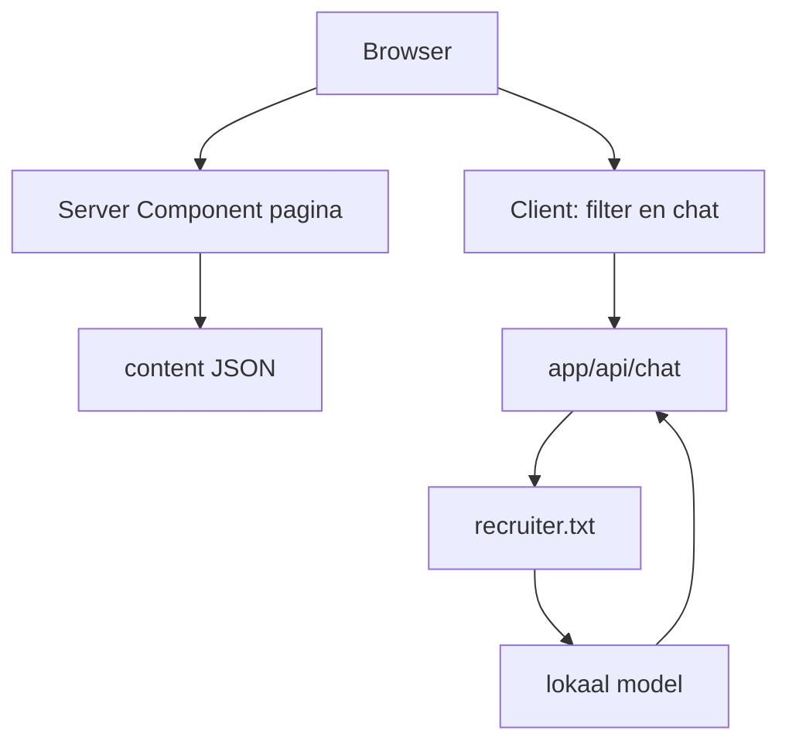

# Portfolio

Deze site is een herbouw van een Angular 16-portfolio. Het doel is niet een visuele kopie, maar een kleine applicatie waarvan je kunt uitleggen waar de data leeft, hoe de staat gedeeld wordt, en waar een model wel en niet bij mag.

De pagina is React op de Next.js App Router. De vorm volgt het oude ontwerp: bordeaux, Raleway en Mulish, kaarten en een tijdlijn. De stijl staat in Tailwind, als tokens in `src/app/globals.css`. Eén stylingsysteem is genoeg. Een tweede componentbibliotheek zou de look namaken die Tailwind hier al vastlegt.

## Wat de architectuur moet laten zien

Drie grenzen zijn bewust klein gehouden.

De pagina is een document. Persoonsgegevens, skills, projecten en banners komen uit JSON op de server. De browser haalt die bestanden niet op en praat niet met een content-API. Leeftijd en aantal jaar als developer worden bij het renderen uit datums afgeleid, zodat de tekst niet veroudert doordat iemand een getal in de JSON vergeet bij te werken.

Het filter is URL-staat. `/?keywords=Angular&keywords=React#werk` is de selectie. Een lege selectie toont alles. Meerdere trefwoorden zijn een OF-filter, zoals in de oude store. Onbekende trefwoorden vallen weg. De eerste response filtert op de server. Een klik werkt de lijst bij zonder de viewport te verplaatsen: de client schrijft dezelfde URL met `scroll: false`, en de terugknop synchroniseert via `popstate`. De link wijst naar `#werk`, zodat een gewone paginaload bij de lijst uitkomt.

De chat is een eiland in dezelfde app. Het venster rechtsonder praat alleen met `app/api/chat`. De sleutel blijft in de omgeving en ondertekent het gesprek. Een antwoord over de persoon komt van het lokale model, op basis van `content/rag/recruiter.txt`.



## Eén Next.js-app

Pagina, content, chatroute en profielindex draaien in hetzelfde proces. Dat is een monoliet, en hier is dat de betere grens.

Een monorepo loont als pakketten een eigen release hebben of als meerdere apps dezelfde bibliotheek delen. Deze site heeft één deploy en geen tweede consument van de index. Een package boundary zou types en scripts splitsen zonder een eigenaar te geven.

Het webproces blijft één Next.js-app. Ollama draait daarnaast: een lokaal model heeft een eigen runtime en een eigen schijfcache, en die horen niet in het Node-proces. Die grens staat in `docs/adr/0001-lokaal-qwen.md`. De chat stuurt het gesprek naar die runtime, met het recruiterblad als gegevens. De browser ziet alleen `/api/chat`.

De bron staat in `src/`. Twee bounded contexts, `portfolio` en `assistant`, elk met `domain`, `application`, `infrastructure` en `interface`. `src/app` bedraadt die modules en bevat geen beslisregels. `server-only` op adapters die bestanden lezen of de sleutel zien laat de build stuklopen als een clientcomponent ze importeert. Het domain importeert geen React, dus leeftijd, filter, id's en het gesprek zijn te testen zonder de pagina op te bouwen. De importregel wordt afgedwongen door `src/shared/kernel/architecture.test.ts`.

## Van bestand naar pagina

`JsonPortfolioRepository` leest `content/*.json`. De anti-corruptielaag in `portfolio-document.ts` controleert de vorm van het document. `assemblePortfolio` maakt daar het aggregate van. Die scheiding maakt de documentcontrole testbaar zonder het filesystem, en de repository testbaar tegen de echte voorbeeldbestanden.

`composePortfolioPage` maakt er een read-model van: leeftijd, jaren als developer, skillgroepen, de geldige trefwoordselectie en de gefilterde projecten. Project-id's zijn de volgorde in het bestand plus één. `PortfolioView` rendert dat model. Alleen het filter en de chat zijn clientcomponenten, omdat alleen die interactie hebben na de eerste response. De URL-hrefs horen bij de interface, de selectieregel bij het domain.

## Chat en streaming

`ChatWidget` is het venster. `useChat` stuurt het gesprek naar de route. De route is een dunne Next-adapter op `handleVisitorChat`. Die controleert het tempo, herstelt het gesprek en opent een sessie. De sessie leest het recruiterblad, zet die feiten in de prompt en streamt het antwoord van het model naar de browser.

`AI_MODEL` zet de chat aan. `.env.example` zet `qwen`. De route weigert het verzoek als model of sleutel ontbreekt, en het venster toont die zin in plaats van een rauwe foutpagina. `AI_BASE_URL` blijft een lokaal adres: zonder die variabele geldt `http://127.0.0.1:11434/v1`, en een adres buiten deze machine of het Docker-netwerk wordt geweigerd. De sessie stuurt het gesprek daarheen. `AI_API_KEY` ondertekent het gesprek en gaat niet mee in dat verzoek. `OLLAMA_URL` voor de dagelijkse review volgt dezelfde grens.

Binnenkomende berichten worden gecontroleerd: alleen gebruiker en assistent, een begrensd aantal, alleen tekst, en een maximumlengte. Het lichaam van het verzoek stopt bij 96 kB, ook als de lengtekop ontbreekt of te laat komt. Tool-onderdelen uit de browser worden weggegooid. Een assistentbericht telt alleen mee als deze server het zelf ondertekend heeft met `AI_API_KEY`. Een verzonnen antwoord komt niet in de volgende prompt terecht. De handtekening gaat mee in de stream en komt bij de volgende beurt terug. Wisselt de sleutel, dan vervalt de oude geschiedenis.

Elk gesprek landt in één tekstbestand. De eerste vraag van de bezoeker is de naam van dat gesprek; een vervolgvraag vervangt hetzelfde bestand met het hele gesprek tot dan toe. Zonder `CHAT_LOG_DIR` staat de map op `CONTENT_DIR/chat`, en zonder `CONTENT_DIR` op `data/chat` in de werkmap. Een herladen pagina begint een nieuw gesprek. De sleutel staat niet in het bestand.

`/api/chat` heeft geen login. Per adres geldt een venster van 8 verzoeken per minuut. Per proces geldt daarnaast 100 verzoeken per tien minuten, ook als het adres in `x-forwarded-for` meedraait. Daarboven antwoordt de route met 429, vóórdat een antwoord wordt opgebouwd. Een ongeldig gesprek telt mee voor dat venster. Het plafond zit in het geheugen van dit proces. Een adres waarvan het venster leeg is, verlaat de tabel. Meerdere instances delen het niet. Een fout gaat als vaste zin naar de browser, niet als ruwe fouttekst.

## Profiel voor de chat

De chat leest `content/rag/recruiter.txt`. Dat blad noemt de persoon, de opleiding, twee datums, de vaardigheden en per project de stack. Het domain maakt daar een briefing van, met leeftijd en jaren interfaces uitgerekend op de dag van het verzoek. Die briefing is de hele context van het model. Het model schrijft het antwoord. Staat een feit er niet, dan hoort het antwoord te zijn: dat staat niet in het profiel. Salaris en een startdatum staan er niet in.

Een eerdere versie liet een klein model zelf zoeken of de zin kiezen. Dat veranderde projecten, vaardigheden en datums. De briefing geeft daarom het hele blad, niet een gefilterde zin, en de datums zijn al uitgerekend. `pnpm qwen` en de Compose-service maken het model `qwen` aan. Zonder dat model komt er geen antwoord. Het besluit staat in `docs/adr/0003-model-antwoordt.md`.

Het corpus is verder de map `content/rag`. Elk tekstbestand telt voor de index: `.txt`, `.md` en `.markdown`. `RecursiveCharacterTextSplitter` uit LangChain knipt de documenten op tekengrootte, met overlap. Okapi BM25 (`okapibm25`) rangschikt die stukken. De store cachet ze en bouwt ze opnieuw als een bestandsnaam, wijzigingstijd of grootte verandert. Een bestand groter dan 64 kB wordt geweigerd.

Zonder `RAG_DOCUMENT_PATH` worden alle tekstbestanden geïndexeerd. Met die variabele blijft de index bij één bestandsnaam. Het recruiterblad wordt daar los van gelezen, altijd als `recruiter.txt` in dezelfde map. Een pad met een map of `..` wordt geweigerd, net als een andere extensie. `realpath` moet daarna binnen `content/rag` blijven. De route neemt de map mee in de file trace.

`content/rag/profile.txt` en `content/rag/werk.txt` beschrijven dezelfde demopersona. Echte content hoort niet in de repo. Zet `CONTENT_DIR` op een absolute map buiten de checkout. Die map heeft dezelfde JSON-bestanden en `rag/` als `content/`, inclusief `recruiter.txt`, plus `images/` zoals `content/images`. De pagina en de chat lezen die map bij elk verzoek. Een deploy vervangt de code en laat de map staan. Ontbreekt `CONTENT_DIR`, dan geldt de demo in de checkout.

## Naden

Elke context houdt dezelfde volgorde aan: document of verzoek naar binnen, domain beslist, interface tekent.

`src/app/api/chat/route.ts` geeft het verzoek door aan de assistant-module. De sessie zit in `createLocalQwenSession`. De route importeert die niet.

`ProfileKnowledge` is de poort naar de feiten. `facts` leest het recruiterblad. `search` blijft de BM25-index: `FileProfileStore` leest de tekstbestanden, laat LangChain ze splitsen, rangschikt met BM25, weigert iets groters dan 64 kB, en cachet de stukken op het eigen object.

Het venster toont de zin uit het antwoord van de route. Een pagina of stacktrace wordt de vaste zin dat het antwoord niet lukte. Het herstellen van een gesprek blijft in het domain.

## Tests

`pnpm test` draait Vitest.

Domeintests dekken datums, het filter, project-id's, de contentvalidatie, het recruiterblad en de profielstore, inclusief een vervangen bestand, een map met tekst én markdown, en een pad dat buiten de map wijst. Componenttests dekken de kaart, de skills, het filter en het chatvenster.

De routetest controleert dat een vraag het model bereikt met de feiten uit het blad, en dat een verzonnen assistentantwoord niet in die prompt belandt. Een tweede test stuurt de stream van het model door de echte SDK en controleert dat de tekst ondertekend is en dat de sleutel niet in het modelverzoek staat.

`pnpm test:e2e` draait Playwright tegen een productiebuild. Die suite dekt de pagina, het filter, de chat en de agentpagina. Het filter wordt gecontroleerd in de eerste HTML, na een klik, met de terugknop, zonder JavaScript, en zonder dat die klik de scrollpositie verschuift. De chat dekt openen en sluiten, de poster over de pagina, een leeg bericht, een antwoordstroom, stoppen, een ruwe foutpagina, en de zinnen die `/api/chat` teruggeeft. Zonder `AI_MODEL` en `AI_API_KEY` antwoordt die route met 503. Een ongeldige of te grote body wordt geweigerd voordat het model eraan te pas komt. Een wijziging aan wat de bezoeker ziet, werkt die suite bij in dezelfde wijziging. De regel staat in `.cursor/rules/tests.mdc`.

Elke pull request en elke featuretak draait `pnpm test` en `pnpm test:e2e` via `.github/workflows/ci.yml`. Een push naar `master` of `development` wacht op die twee jobs voordat de site wordt gepubliceerd.

```bash
pnpm exec playwright install chromium
```

## Lokaal draaien

```bash
pnpm install
cp .env.example .env.local
pnpm qwen
pnpm dev
pnpm test
pnpm exec playwright install chromium
pnpm test:e2e
pnpm typecheck
pnpm build
pnpm start
```

`.env.local`:

```
AI_MODEL=qwen
AI_BASE_URL=http://127.0.0.1:11434/v1
AI_API_KEY=
```

`pnpm qwen` start Ollama als die nog niet draait, en maakt het model `qwen` uit `qwen/Modelfile`. De eerste keer downloadt dat `qwen2.5:3b`, ongeveer 1,9 GB. De chat heeft die runtime nodig voor een antwoord. Zet in `AI_API_KEY` een eigen geheim; die regel ondertekent het gesprek en gaat niet mee naar het model. Zonder model of sleutel werkt de pagina. De chat antwoordt dan dat model en sleutel gezet moeten worden.

## Container

`output: "standalone"` levert één Node-server zonder de volledige `node_modules`. De Dockerfile kopieert daarnaast `public/`, `.next/static/` en `content/`. De pagina en de chat lezen `content/` bij het verzoek van schijf, dus die map staat in de image.

```bash
cp .env.example .env
docker compose up -d --build
```

De site luistert op `127.0.0.1:3000`. Compose zet `AI_MODEL=qwen` en `AI_BASE_URL=http://qwen:11434/v1`. `AI_API_KEY` komt uit `.env` bij het starten van de site. Sleutel en gewichten worden niet in de Next-image gebakken. De service `qwen` laadt het model in volume `qwen`. De chat wacht op dat model. Is het er nog niet, dan krijgt de bezoeker de zin dat het antwoord niet lukte.

Op de VPS draait de site als het standalone archief uit de deploy, niet via Compose. Het archief bevat `qwen/`, zodat `sh qwen/start.sh` het model daar kan aanmaken. De chat leest `recruiter.txt` uit `CONTENT_DIR/rag` als die variabele gezet is. `deploy/portfolio.service` houdt het proces op `127.0.0.1:3000`.

Nginx staat ervoor. `deploy/ssl` schrijft die vhost, zet `X-Real-IP` en laat `/api/chat` ongebuffert. Poort 80 stuurt door naar HTTPS en blijft `/.well-known/acme-challenge/` uitserveren. Zonder `SITE_ADDRESS` vraagt Certbot een certificaat voor het publieke IPv4-adres. Dat certificaat geldt zes dagen. De timer van Certbot vernieuwt het en herlaadt Nginx. Met `SITE_ADDRESS` op een hostnaam die naar deze machine wijst, komt het certificaat op die naam. `CERTBOT_EMAIL` is het adres voor het verloopbericht.

```bash
sudo sh deploy/ssl
```

## Development

GitFlow met twee langlevende takken. `master` is productie. `development` is de testomgeving, op één subdomein. Feature branches worden niet gedeployed. Die merge je in `development`. Staat de testomgeving goed, dan merge je `development` naar `master`.

De app blijft op `/` staan. Filter, beelden en `/api/chat` veranderen niet. Development luistert op `127.0.0.1:3001`, naast productie op poort 3000.

De deploy-sleutel start alleen het commando `run`. Eenmalig op de VM, in deze volgorde, zodat productie het oude script houdt. Draai dit vanuit een checkout, of kopieer `deploy/run` eerst naar de VM.

```bash
target=$(command -v run)
mkdir -p ~/.local/lib/portfolio
cp "$target" ~/.local/lib/portfolio/run-production
chmod 755 ~/.local/lib/portfolio/run-production
install -m 755 deploy/run ~/.local/lib/portfolio/run
printf '%s\n' '#!/bin/sh' 'exec "$HOME/.local/lib/portfolio/run"' > "$target"
chmod 755 "$target"
```

Staat in `~/.ssh/authorized_keys` een `command=` met een pad, dan is dat pad `target`. Daarna maakt `git push -u origin development` de tak aan vanaf `master`. Elke push naar `development` publiceert de site. `run` zonder meer blijft de productiedeploy.

`~/.config/portfolio/development.env` volgt `deploy/development.env.example`, met `chmod 600`. `DEVELOPMENT_DOMAIN` is de hostnaam. `CONTENT_DIR` mag dezelfde map zijn als productie. Op de VM staat Node 22 op het PATH.

DNS wijst die hostnaam naar dezelfde machine. De bestaande proxy stuurt haar naar `127.0.0.1:3001`, zet `X-Real-IP`, en buffert `/api/chat` niet. `deploy/caddy-development.caddy` en `deploy/nginx-development.conf` zijn die vhost. Zet daar basic auth op zolang de chat-sleutel dezelfde is als productie.

## Agents

Drie agents kijken elke dag naar de pagina en de code. De ene let op UI en gebruik, de tweede op de content, de derde op vindbaarheid. Ze lezen eerst de oudere markdownrapporten. Een run schrijft drie nieuwe bestanden onder `content/reviews/`, of onder `CONTENT_DIR/reviews` als die variabele gezet is. `/agents` toont alleen die voorstellen, elk met een score van 1 tot 10 en het gemiddelde van die dag. Sleutels, wachtwoorden, ip-adressen, e-mailadressen en absolute paden worden uit het rapport gehaald voordat het op de pagina staat.

De run praat met Qwen via Ollama op `OLLAMA_URL` (standaard `http://127.0.0.1:11434`). Een adres buiten deze machine of het Docker-netwerk wordt geweigerd. `QWEN_MODEL` is standaard `qwen`. `REVIEW_SOURCE_DIR` is de checkout die de agents lezen. Er gaat geen API-sleutel mee.

```bash
pnpm review:daily
```

Op de machine waar Ollama draait kan dat dagelijks via de voorbeelden `deploy/review-daily.service` en `deploy/review-daily.timer`, om 07:00 Europe/Amsterdam. De timer verwacht een checkout in `~/portfolio-src`.

## Content vervangen

De JSON in `content/` is democontent over Noor Linden, een verzonnen frontend developer. Het vak en de stack lijken op een echte frontendpraktijk. De naam, de plaats Kadewijk, de opdrachtgevers en de campagnes zijn verzonnen, en volledig genoeg om filter, banners, vaardigheden en chat te gebruiken. De balk bovenin en de voettekst zeggen dat het geen echt cv is. De twee banners zijn fictieve campagnes, Festival Noordlicht en Circuit Meridiaan.

- `content/personal.json` — profiel van Noor Linden. `${age}` en `${yearsAsDeveloper}` in `foreword` worden op de server ingevuld vanuit `dateOfBirth` en `developingStartDate`. Die twee datums zijn voorbeelddata.
- `content/skills.json` — `category` is `skills`, `framework` of `other`.
- `content/projects.json` — de id is de volgorde in het bestand plus één.
- `content/banners.json` — paden onder `/images/`.
- `content/rag/` — `recruiter.txt` is het blad dat het model als feiten krijgt. `profile.txt` is de persoon, `werk.txt` de projecten. Alles is democontent. Andere `.txt`-, `.md`- of `.markdown`-bestanden in die map tellen mee voor de index, tenzij `RAG_DOCUMENT_PATH` er één van aanwijst. Op de server staat deze map onder `CONTENT_DIR`, niet in git. De balk in de header en de regel in de voettekst horen bij deze demo; die zinnen staan in de code, niet in de JSON.

Beelden staan in `content/images/`. `/images` leest die map via de route, niet via `public/`, omdat Next statische bestanden eerder serveert dan een dynamische route. Daardoor vervangt `CONTENT_DIR/images` de demobestanden. De response zet `nosniff` en een beleid zonder scripts, zodat een svg geen pagina wordt.
