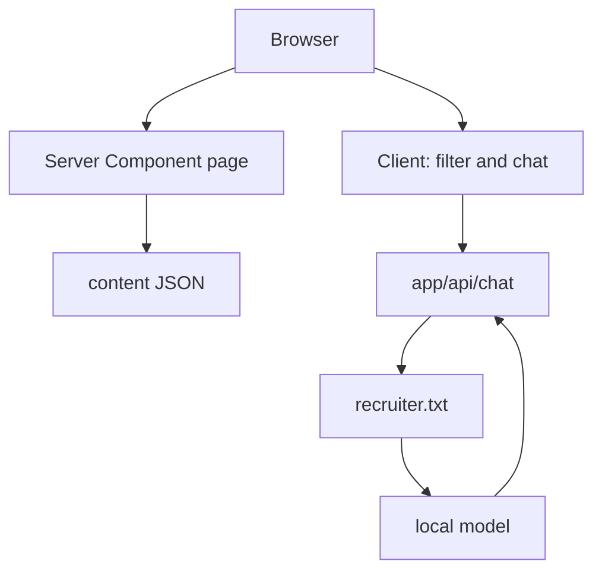

# Portfolio

This site is a rebuild of an Angular 16 portfolio: a small application whose data, shared state, and model boundaries stay explainable.

The page is React on the Next.js App Router. The shape follows the earlier design: bordeaux, Raleway and Mulish, cards and a timeline. Styles live in Tailwind, as tokens in `src/app/globals.css`.

## What the architecture shows

Three boundaries stay small on purpose.

The page is a document. Personal details, skills, projects, and banners come from JSON on the server. The browser does not fetch those files and does not talk to a content API. Age and years as a developer are derived from dates at render time, so the text stays current when nobody edits a number in the JSON.

The filter is URL state. `/?keywords=Angular&keywords=React#werk` is the selection. An empty selection shows everything. Several keywords are an OR filter, as in the old store. Unknown keywords drop out. The first response filters on the server. A click updates the list and leaves the viewport where it is: the client writes the same URL with `scroll: false`, and the back button stays in sync through `popstate`. The link points at `#werk`, so a full page load opens on the list.

The chat is an island in the same app. The window at the bottom right talks only to `app/api/chat`. The key stays in the environment and signs the conversation. An answer about the person comes from the local model, using `content/rag/recruiter.txt`.



## Run locally

```bash
pnpm install
cp .env.example .env.local
pnpm qwen
pnpm dev
pnpm test
pnpm exec playwright install chromium
pnpm test:e2e
pnpm typecheck
pnpm build
pnpm start
```

`.env.local`:

```
AI_MODEL=qwen
AI_BASE_URL=http://127.0.0.1:11434/v1
AI_API_KEY=
```

`pnpm qwen` starts Ollama when it is not already running, and creates the model `qwen` from `qwen/Modelfile`. The first run downloads `qwen2.5:3b`, about 1.9 GB. The chat needs that runtime to answer. Put your own secret in `AI_API_KEY`. That value signs the conversation and is not sent to the model. The page works without a model or a key. The chat then says that the model and the key have to be set.

## Read on

- [Architecture](docs/architecture.md) explains the module boundaries, how a file becomes a page, and where the seams sit.
- [Chat](docs/chat.md) covers the route, the signed transcript, the recruiter sheet, and the profile index.
- [Testing](docs/testing.md) covers Vitest, Playwright, and the release gate.
- [Deploy](docs/deploy.md) covers the container, the VPS, HTTPS, and the daily review.
- [Development](docs/development.md) covers the `development` branch and its host.
- [Content](docs/content.md) covers the JSON files and `CONTENT_DIR`.
