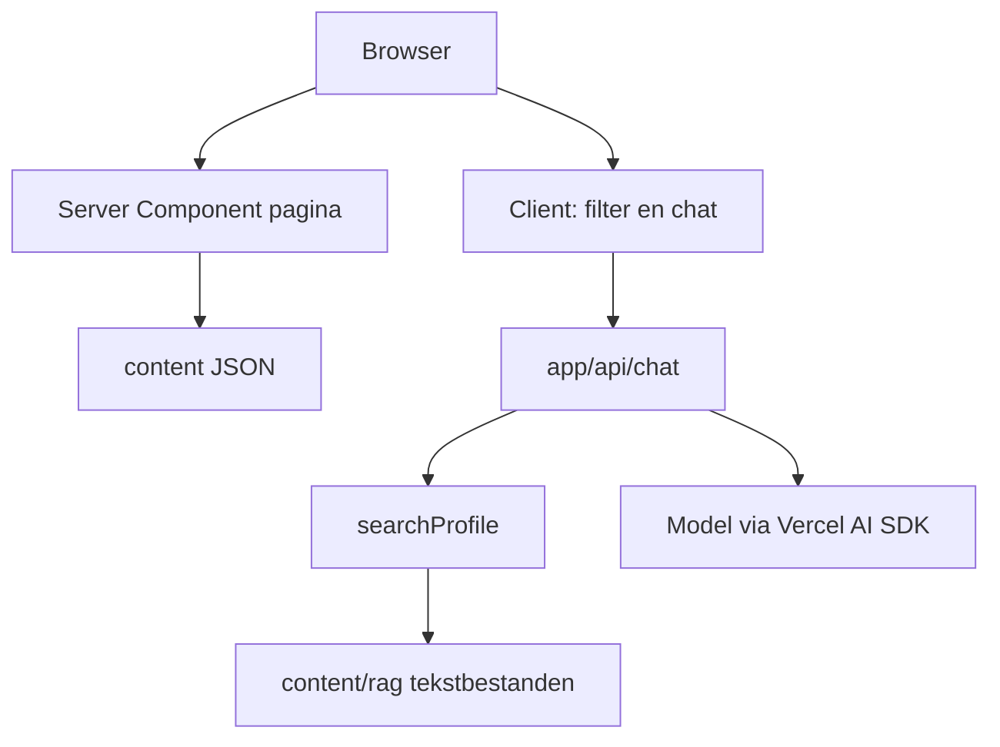

# Portfolio

Deze site is een herbouw van een Angular 16-portfolio. Het doel is niet een visuele kopie, maar een kleine applicatie waarvan je kunt uitleggen waar de data leeft, hoe de staat gedeeld wordt, en waar een model wel en niet bij mag.

De pagina is React op de Next.js App Router. De vorm volgt het oude ontwerp: bordeaux, Raleway en Mulish, kaarten en een tijdlijn. De stijl staat in Tailwind, als tokens in `src/app/globals.css`. Eén stylingsysteem is genoeg. Een tweede componentbibliotheek zou de look namaken die Tailwind hier al vastlegt.

## Wat de architectuur moet laten zien

Drie grenzen zijn bewust klein gehouden.

De pagina is een document. Persoonsgegevens, skills, projecten en banners komen uit JSON op de server. De browser haalt die bestanden niet op en praat niet met een content-API. Leeftijd en aantal jaar als developer worden bij het renderen uit datums afgeleid, zodat de tekst niet veroudert doordat iemand een getal in de JSON vergeet bij te werken.

Het filter is URL-staat. `/?keywords=Angular&keywords=React#werk` is de selectie. Een lege selectie toont alles. Meerdere trefwoorden zijn een OF-filter, zoals in de oude store. Onbekende trefwoorden vallen weg. De eerste response filtert op de server. Een klik werkt de lijst bij zonder de viewport te verplaatsen: de client schrijft dezelfde URL met `scroll: false`, en de terugknop synchroniseert via `popstate`. De link wijst naar `#werk`, zodat een gewone paginaload bij de lijst uitkomt.

De chat is een eiland in dezelfde app. Het venster rechtsonder praat alleen met `app/api/chat`. Model en sleutel blijven in de omgeving. Het model mag feiten over de persoon alleen ophalen via een tool, uit de tekstbestanden in `content/rag`.



## Eén Next.js-app

Pagina, content, chatroute en profielindex draaien in hetzelfde proces. Dat is een monoliet, en hier is dat de betere grens.

Een monorepo loont als pakketten een eigen release hebben of als meerdere apps dezelfde bibliotheek delen. Deze site heeft één deploy en geen tweede consument van de index. Een package boundary zou types en scripts splitsen zonder een eigenaar te geven.

Een aparte Node-server voor het model loont als meer producten hetzelfde model gebruiken, als dat proces apart moet schalen, of als het model buiten het webproces moet blijven. Deze chat bestaat alleen voor deze pagina. Een tweede server betekent een tweede deploy, CORS, en een sleutel op nog een plek. De Vercel AI SDK streamt vanuit een Route Handler. De browser ziet alleen `/api/chat`.

De bron staat in `src/`. Twee bounded contexts, `portfolio` en `assistant`, elk met `domain`, `application`, `infrastructure` en `interface`. `src/app` bedraadt die modules en bevat geen beslisregels. `server-only` op adapters die bestanden lezen of de sleutel zien laat de build stuklopen als een clientcomponent ze importeert. Het domain importeert geen React, dus leeftijd, filter, id's en het gesprek zijn te testen zonder de pagina op te bouwen. De importregel wordt afgedwongen door `src/shared/kernel/architecture.test.ts`.

## Van bestand naar pagina

`JsonPortfolioRepository` leest `content/*.json`. De anti-corruptielaag in `portfolio-document.ts` controleert de vorm van het document. `assemblePortfolio` maakt daar het aggregate van. Die scheiding maakt de documentcontrole testbaar zonder het filesystem, en de repository testbaar tegen de echte voorbeeldbestanden.

`composePortfolioPage` maakt er een read-model van: leeftijd, jaren als developer, skillgroepen, de geldige trefwoordselectie en de gefilterde projecten. Project-id's zijn de volgorde in het bestand plus één. `PortfolioView` rendert dat model. Alleen het filter en de chat zijn clientcomponenten, omdat alleen die interactie hebben na de eerste response. De URL-hrefs horen bij de interface, de selectieregel bij het domain.

## Chat en streaming

`ChatWidget` is het venster. `useChat` stuurt het gesprek naar de route. De route is een dunne Next-adapter op `handleVisitorChat`. Die herstelt het gesprek, controleert het tempo en opent een Anthropic-sessie. De sessie roept `streamText` aan en geeft de stream terug als UI-messagestream. Tokens komen binnen terwijl het model nog schrijft.

`AI_MODEL` is het model-id. `claude-haiku-5-5` in `.env.example` is een voorbeeld, geen keuze die in de code vastzit. `AI_API_KEY` gaat naar de Anthropic-provider op de server. De route weigert het verzoek als een van beide ontbreekt, en het venster toont die zin in plaats van een rauwe JSON-body.

Binnenkomende berichten worden gecontroleerd: alleen gebruiker en assistent, een begrensd aantal, alleen tekst, en een maximumlengte. Het lichaam van het verzoek stopt bij 96 kB. Tool-onderdelen uit de browser worden weggegooid. Een assistentbericht telt alleen mee als deze server het zelf ondertekend heeft met `AI_API_KEY`, of als het de vaste welkomstzin is. Een verzonnen antwoord of een verzonnen toolresultaat bereikt het model niet. De handtekening gaat mee in de stream en komt bij de volgende beurt terug. Wisselt de sleutel, dan vervalt de oude geschiedenis.

`/api/chat` heeft geen login. Zonder plafond kan een bezoeker de sleutel leegtrekken. Per adres geldt een venster van 8 verzoeken per minuut. Per proces geldt daarnaast 100 verzoeken per tien minuten, ook als het adres in `x-forwarded-for` meedraait. Daarboven antwoordt de route met 429, vóórdat het model wordt aangeroepen. Het plafond zit in het geheugen van dit proces. Meerdere instances delen het niet. Een fout van de provider gaat als vaste zin naar de browser, niet als ruwe fouttekst.

`stopWhen: isStepCount(4)` laat het model een tool aanroepen en daarna nog antwoorden, en kapt een lus af voordat een vastgelopen gesprek de sleutel blijft gebruiken. De zoekterm uit het model is begrensd op 200 tekens.

## Profiel als RAG, zonder vectordatabase

`searchProfile` is een tool van de Vercel AI SDK. Het model moet die tool aanroepen voordat het iets over de persoon beweert, en het mag alleen de teruggegeven fragmenten gebruiken.

Het corpus is de map `content/rag`. Elk tekstbestand telt: `.txt`, `.md` en `.markdown`. Markdown mag, maar het formaat is geen eis. `RecursiveCharacterTextSplitter` uit LangChain knipt de documenten op tekengrootte, met overlap, en kijkt niet naar koppen. Okapi BM25 (`okapibm25`, hetzelfde algoritme als de BM25-retriever van LangChain) rangschikt die stukken. Een score van nul of lager valt weg, zodat een vraag die niets raakt geen fragmenten oplevert. De drie beste stukken gaan terug, met de bestandsnaam erbij.

De store cachet de stukken en bouwt ze opnieuw als een bestandsnaam, wijzigingstijd of grootte verandert. Een bestand vervangen op de server is genoeg. Een bestand groter dan 64 kB wordt geweigerd, zodat een deploy het proces niet kan vullen met één tekst.

Dit is retrieval-augmented generation in de kleine vorm. Het model krijgt niet het hele profiel in de systeemprompt, maar de stukken die bij de vraag horen. Vindt de tool niets, dan zegt de instructie dat het niet in het profiel staat.

Een embeddingmodel en een vectordatabase zijn hier een tweede systeem voor een korte tekst, en ze vragen een tweede sleutel. BM25 draait lokaal, is uitlegbaar, en is te testen zonder het model. Dezelfde toolgrens blijft staan als het corpus later groot genoeg wordt voor embeddings: de route blijft `searchProfile` aanroepen, de index erachter kan dan veranderen.

Zonder `RAG_DOCUMENT_PATH` worden alle tekstbestanden in de map geïndexeerd. Met die variabele blijft het bij één bestandsnaam. Een pad met een map of `..` wordt geweigerd, net als een andere extensie. `realpath` moet daarna binnen `content/rag` blijven, zodat een symlink het corpus niet naar een bestand buiten die map trekt. De route neemt de map expliciet mee in de file trace, omdat de bestandsnaam pas bij deploy vaststaat.

`content/rag/profile.txt` en `content/rag/werk.txt` beschrijven dezelfde demopersona. Echte content hoort niet in de repo. Zet `CONTENT_DIR` op een absolute map buiten de checkout. Die map heeft dezelfde JSON-bestanden en `rag/` als `content/`, plus `images/` in de vorm van `public/images`. De pagina en de chat lezen die map bij elk verzoek. Een deploy vervangt de code en laat de map staan. Ontbreekt `CONTENT_DIR`, dan geldt de demo in de checkout.

## Naden

Elke context houdt dezelfde volgorde aan: document of verzoek naar binnen, domain beslist, interface tekent.

`src/app/api/chat/route.ts` geeft het verzoek door aan de assistant-module. De provider zit in `createAnthropicSession`. Een andere provider vervangt die adapter. De route importeert de provider niet.

`ProfileKnowledge` is de poort naar de feiten. `FileProfileStore` is de huidige adapter: hij leest de tekstbestanden, laat LangChain ze splitsen, rangschikt met BM25, weigert iets groters dan 64 kB, en cachet de stukken op het eigen object. Een latere adapter kan dezelfde poort vullen met embeddings. De tool en de route blijven staan.

Het venster importeert de fouttekst die het aan de bezoeker toont, en de welkomstzin uit het domain. Het herstellen van een gesprek blijft in het domain.

## Tests

`pnpm test` draait Vitest.

Domeintests dekken datums, het filter, project-id's, de contentvalidatie en de profielstore, inclusief een vervangen bestand, een map met tekst én markdown, en een pad dat buiten de map wijst. Componenttests dekken de kaart, de skills, het filter en het chatvenster, ook de regel die verschijnt terwijl de tool zoekt.

De routetest controleert dat `searchProfile` aan de stream hangt, dat een zoekopdracht op "opleiding" het fragment met de Voorbeeld Hogeschool teruggeeft, en dat een verzonnen assistentantwoord het model niet bereikt. Een tweede test stuurt een nagebootste Anthropic-stream door de echte SDK en controleert dat de tekst in het antwoord naar de browser zit, dat die tekst ondertekend is, en dat de sleutel niet in het antwoord staat.

`pnpm test:e2e` draait Playwright tegen een productiebuild. Die suite dekt de pagina, het filter en de chat. Het filter wordt gecontroleerd in de eerste HTML, na een klik, met de terugknop, zonder JavaScript, en zonder dat die klik de scrollpositie verschuift. De chat dekt openen en sluiten, een leeg bericht, een antwoordstroom, het zoeken in het profiel, stoppen, en de zinnen die `/api/chat` teruggeeft. Zonder `AI_MODEL` en `AI_API_KEY` antwoordt die route met 503. Een ongeldige of te grote body wordt geweigerd voordat het model eraan te pas komt.

```bash
pnpm exec playwright install chromium
```

## Lokaal draaien

```bash
pnpm install
cp .env.example .env.local
pnpm dev
pnpm test
pnpm exec playwright install chromium
pnpm test:e2e
pnpm typecheck
pnpm build
pnpm start
```

`.env.local`:

```
AI_MODEL=claude-haiku-5-5
AI_API_KEY=
```

Zonder die twee variabelen werkt de pagina. De chat antwoordt dan dat model en sleutel gezet moeten worden.

## Container

`output: "standalone"` levert één Node-server zonder de volledige `node_modules`. De Dockerfile kopieert daarnaast `public/`, `.next/static/` en `content/`. De pagina en de chat lezen `content/` bij het verzoek van schijf, dus die map staat in de image.

```bash
cp .env.example .env
docker compose up -d --build
```

De site luistert op `127.0.0.1:3000`. Een proxy ervoor zet HTTPS en `X-Real-IP`. Die proxy mag `/api/chat` niet bufferen, anders komt de stream pas binnen als het model klaar is. `AI_MODEL` en `AI_API_KEY` komen uit `.env` bij het starten van de container. Ze worden niet in de image gebakken.

## Content vervangen

De JSON in `content/` is democontent over Noor Linden, een verzonnen frontend developer. Het vak en de stack lijken op een echte frontendpraktijk. De naam, de plaats Kadewijk, de opdrachtgevers en de campagnes zijn verzonnen, en volledig genoeg om filter, banners, vaardigheden en chat te gebruiken. De balk bovenin en de voettekst zeggen dat het geen echt cv is. De twee banners zijn fictieve campagnes, Festival Noordlicht en Circuit Meridiaan.

- `content/personal.json` — profiel van Noor Linden. `${age}` en `${yearsAsDeveloper}` in `foreword` worden op de server ingevuld vanuit `dateOfBirth` en `developingStartDate`. Die twee datums zijn voorbeelddata.
- `content/skills.json` — `category` is `skills`, `framework` of `other`.
- `content/projects.json` — de id is de volgorde in het bestand plus één.
- `content/banners.json` — paden onder `/images/`.
- `content/rag/` — de tekst die de chat mag gebruiken. `profile.txt` is de persoon, `werk.txt` de projecten. Beide zijn democontent. Andere `.txt`-, `.md`- of `.markdown`-bestanden in die map tellen mee, tenzij `RAG_DOCUMENT_PATH` er één van aanwijst. Op de server staat deze map onder `CONTENT_DIR`, niet in git. De balk in de header en de regel in de voettekst horen bij deze demo; die zinnen staan in de code, niet in de JSON.

Beelden staan in `public/images/`.
